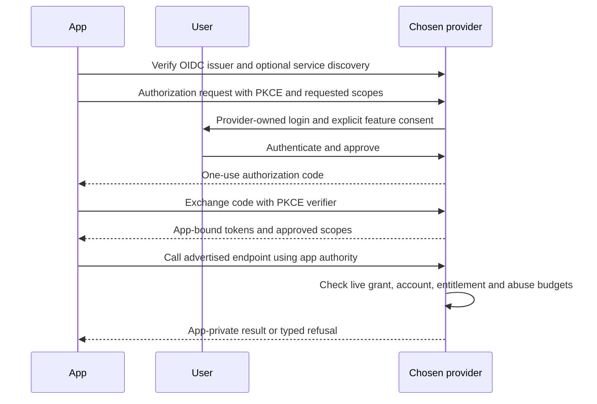

# Optional service discovery and app authority

> **Status:** Proposed design; implementation varies. Consult the implementation map and release gates.

Reference extension profile, 2026-11-02. OIDC/OAuth/WebAuthn remain existing standards. This document describes the additional discovery seam for Waypo's optional services; it is not an independently standardized protocol. Node and Worker publish the general capabilities document, and the sample-app BFF resolves advertised service paths after explicit login. The parser and SDK have engine coverage in `tests/engine/services-discovery.test.mjs`. Frozen browser runs `25907b41` (Node) and `2e83065e` (Worker) passed with this integration; public remote interoperability remains a separate gate.

## What an app learns

An app first selects an identity issuer and verifies its OIDC metadata. It can then fetch `https://<issuer-origin>/.well-known/waypo-services`. The public document describes provider capabilities, never whether a person has an account, an active session, a paid plan, grants, notifications or particular devices. Rendering a login button does not require this network request; discovery follows an app's explicit login or feature action.

The document's `issuer` must exactly equal the already selected issuer. Advertised service endpoints must be canonical HTTPS URLs on that issuer's origin, without credentials, queries or fragments. Clients must reject an issuer mismatch rather than trusting a document's self-declared identity. This initial same-origin profile deliberately avoids an additional cross-origin token audience; a provider can reverse-proxy services internally. Self-hosting subpaths remain possible because endpoint paths are discovered, not assumed.

General form, illustrated with reserved example domains:

```json
{
  "version": "waypo-services-v1",
  "issuer": "https://identity.example/api/auth",
  "features": {
    "notifications": {
      "version": "1",
      "endpoint": "https://identity.example/services/notifications",
      "scopes": ["notifications:read", "notifications:write"]
    },
    "storage": {
      "version": "1",
      "documents_endpoint": "https://identity.example/services/documents",
      "codecs": ["yjs-update-v1"],
      "scopes": ["sync:read", "sync:write", "attachments:read", "attachments:write"]
    },
    "signaling": {
      "version": "1",
      "endpoint": "https://identity.example/services/signaling",
      "scopes": ["signaling:read", "signaling:write"]
    }
  },
  "signaling_protocol": "waypo-signaling-v1",
  "signaling_endpoint": "https://identity.example/federation/signaling",
  "federation_jwks_uri": "https://identity.example/federation/keys"
}
```

The last three fields are the existing provider-to-provider signaling profile. They are distinct from the app-facing signaling endpoint and use purpose-specific federation keys, not OIDC identity-token keys. Keep them compatible while adding the general `features` map. A provider with signaling disabled omits those fields. A provider with every optional feature disabled can publish an empty `features` map; identity login still works.

Disabled features are omitted. Unknown optional feature keys and fields are ignored; an app uses only versions and codecs it actually supports. Independent extensions should use a collision-resistant key, such as a URI under their author's domain, and describe their version, endpoints, authority and revocation semantics. They need no Waypo-hosted registry, marketplace or supplier approval. Discovery does not authorize calls, and a newly advertised feature does not expand an existing grant.

Fetch and parser limits, redirect refusal, endpoint validation, cache lifetime and network isolation are mandatory implementation defenses. The existing bounded discovery transport is the baseline. Public limits may describe a provider's supported wire envelope; they must not reveal an individual user's allowance or be treated as a promise that the account is entitled to use it.

## Optional storage invalidation channel

The reference profile can advertise this additional object inside `features.storage`:

```json
{
  "subscriptions": {
    "version": "1",
    "protocol": "waypo-sync-v1",
    "ticket_endpoint": "https://identity.example/opaque/storage-ticket",
    "endpoint": "https://identity.example/opaque/storage-channel"
  }
}
```

Both URLs follow the same selected-issuer origin and canonical-HTTPS rules as the other service endpoints. Paths are opaque. Omit this object when unavailable; an unknown version leaves HTTP synchronization usable. This channel requires current `sync:read` authority. Notification-only clients do not need a paid storage capability merely to read their inbox.

The client posts to the discovered ticket endpoint with its app-bound OAuth authority and exact browser Origin. The provider checks live authority and issues `{ticket, expiresAt}`. The ticket is short-lived, single-use and bound to that Origin and immutable app/account/device authority. It is not an account login credential. In this reference wire profile its opaque syntax is 64 lowercase hex characters, a dot and 16–128 URL-safe characters; clients must not interpret the routing prefix as a portable identity. Providers must use unguessable secrets.

The browser changes only the channel endpoint's scheme from HTTPS to WSS and opens a WebSocket offering two subprotocol values: `waypo-sync-v1` and `waypo-ticket.<ticket>`. Neither an OAuth bearer token nor a query-string credential is used. The server consumes the ticket under the exact Origin and negotiates only `waypo-sync-v1`. Reconnect obtains a fresh ticket through ordinary current OAuth authorization. Tickets expire after at most ten seconds and reference connections after at most fifteen minutes. The SDK bounds handshake waiting and uses HTTP fallback when a channel is unavailable.

An initial or later frame is an invalidation hint, for example:

```json
{
  "type": "invalidate",
  "sequence": 12,
  "resync": true,
  "documents": [{"documentId": "notes", "epoch": "opaque-epoch", "revision": 4}]
}
```

`sequence` and revisions are nonnegative safe integers. Document/epoch identifiers are 1–64 ASCII letters, digits, underscores or hyphens. `resync` and per-document `deleted`, when present, are booleans. Frames contain at most 64 document entries and 16 KiB of UTF-8 JSON. No CRDT bytes, document content, attachment URLs, tokens or other account namespaces travel on this channel. Hints can be duplicated, coalesced or replaced with `resync`; clients retrieve authoritative state through normally authorized HTTP operations and do not apply a hint as document data. The provider checks current accepted authority before publishing; client data frames are refused.

The reference browser adapter coordinates one channel across same-device tabs with a bounded SharedWorker; unavailable coordination falls back to HTTP. Pending edits retain prompt upload/retry scheduling. Only fully synchronized, connected replicas use slower periodic reconciliation. Document locks never surround network work. These coordination, cache, queue and connection-count choices are implementation policy, separate from the discovered wire contract.

Initial local evidence: Node source `5834c61e` and Worker source `df244ec4` passed actual channel frames and seventeen coordinated service scenarios. Later Node source `b9ffc17f` and Worker source `c7b37dba` pass eighteen scenarios plus the consent-lineage regressions and both recovery variants. A 35-second window has no recipient document GETs, while other app polling and a trailing checkpoint PUT remain measured work; this is not a zero-cost claim. These local configured transports do not establish independent implementation conformance or public deployed-provider discovery.

## Login and background operation



Login and optional-feature consent are separate decisions even when presented in one provider visit. A provider can explain an entitlement or trial before granting a paid feature, but billing vendor details are not part of the app protocol. Notifications can remain available under a different policy from paid storage/signaling.

Background work uses approved renewable OAuth authority, including a refresh token only when explicitly permitted. It does not require a live provider browser cookie and never receives that cookie. Browser sign-out ends the provider browser session; app disconnect, security revocation, account enforcement or expiration terminates the appropriate app authority. A provider checks current authority at resource access and before publishing delayed effects. User-facing security/retention notices are a separate provider purpose and cannot be muted by an app's notification rules.

Document and attachment namespaces derive from verified issuer/user/client authority. Apps never gain access by supplying a user ID or origin prefix. Changing accounts creates a distinct local replica/outbox and transport context. Storage exhaustion, unavailable capabilities, ended access and stale epochs must be distinguishable to the app; the provider UI offers the applicable account, export, consent or storage-management path.

## Responsibility boundaries

| Interoperability contract | Reference implementation | Hosted service policy |
| --- | --- | --- |
| Issuer and endpoint binding, supported versions/scopes, app authority, revocation and errors | Better Auth integration, Yjs codec profile, ngin engines, SDK/UI, caches, journals and adapter layout | Which features cost money, included bytes, Polar, trial eligibility and pricing |
| Federation proof audience, purpose, expiry, replay and explicit-recipient authorization | Staff permissions, owner/quorum mechanics, admission queues and storage pagination | Fleet budgets, contact and retention thresholds, supported launch markets |

Internal implementation choices do not require independent providers to reproduce the same libraries, administration model or commercial plan. New wire features need a documented contract and interoperation evidence before being described as supported.

